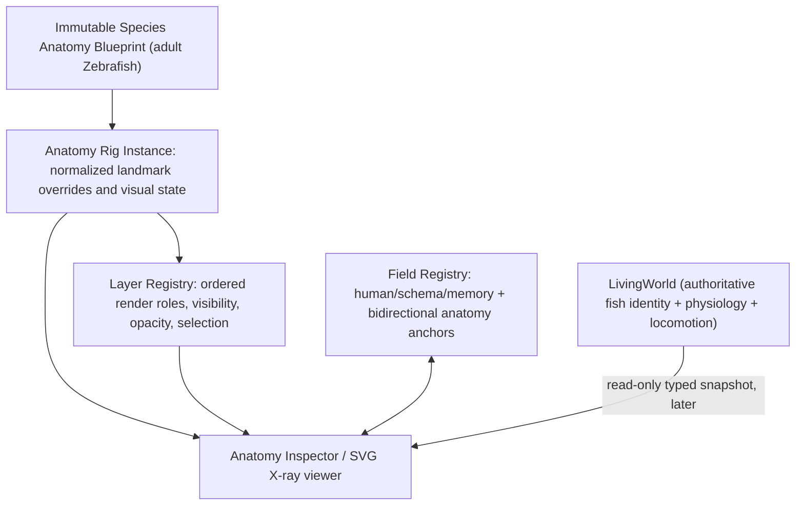

# Anatomy Foundation — M0 Contract and Source Audit

**State:** scoped implementation spike (not a validated anatomical atlas, not a new World). **Date:** 2026-11-20  
**Foundation:** E-001–E-004 are approved design decisions, and six-stage Mechanics Development Contract applies.  
**Work branch:** `feature/anatomy-foundation-v1`, branched from `docs/foundations-refinement`. No merge/deployment without owner approval.

## 1. Existing source audit (original user-provided references)

| User file | Verified inspection | Keep | Limitations |
| --- | --- | --- | --- |
| `index (17).html` (Unified Anatomy Workspace v0.3, ~310 kB) | Embedded `ASCEAN_RIG` pure geometry API, normalized `DEFAULT_LANDMARKS`, presets, `PARTS`, JSON validation v0.3 and legacy v0.2, optional Q16 export, SVG stage, layers, per-part transforms, history | normalized fish frame, landmark semantics, ASCII/illustration independence, layer visibility/lock/opacity, import/export, undo/redo | rig geometry is generic and not an adult Zebrafish atlas; scientific calibration missing; inline code too coupled to transplant whole |
| `standalone(1).html` (D1 True ASCII Fish Rig, ~2.7 MB) | independent ASCII glyph pieces, anchor-linked drawing and experimental image warping, named anatomy parts, local transforms, crop UI | character integrity, local visual transforms and independently togglable warp links | embedded image dominates size; Gaussian warp is illustrative, not anatomical registration; do not copy image blobs |
| `standalone (1).html` (Alive Fish Foundation, ~38 kB) | DOM-free toy `createFish`, `stepFish`, `telemetry`, `assertFish`; 30 Hz fixed tick; discrete events | unit patterns, one World/one fish ID, fixed-step biological data flow and telemetry boundaries | `generic-bony-fish-demo` physiology uses illustrative coefficients; NOT adult Zebrafish calibration |
| `WORKSPACE_IMPLEMENTATION_PLAN.md` | v0.4 interaction proof / stage layout, warp defaults, individual and shared anchor control, requirement to preserve v0.3 editing | preserve plan as behavioral acceptance backlog, staged integrations and no duplicate physics | describes an earlier prototype; NOT production code proof |

**Preservation policy:** do not delete or overwrite the old prototypes. The reference JSON/rig v0.3 should be supported later by explicit import adapter with before/after snapshots and loss report. D1 illustrative biology must not be presented as scientifically supported Zebrafish behavior.

## 2. Scientific source inventory and fidelity policy

- [Zebrafish Anatomy Ontology (ZFA)](https://github.com/ZFIN/zebrafish-anatomical-ontology) and [stage ontology](https://pubmed.ncbi.nlm.nih.gov/24568621/) establish **identities/part-of relationships** and life-stage definitions, not per-individual Cartesian coordinates.
- [Normal Anatomy and Histology of the Adult Zebrafish](https://journals.sagepub.com/doi/10.1177/0192623311409597), [dissection protocol](https://pubmed.ncbi.nlm.nih.gov/20203557/) and [atlas references](https://zfin.atlassian.net/wiki/spaces/general/pages/1892876451/Anatomy%2BAtlases%2Band%2BResources) constrain relative adult organ locations.
- **Important:** an adult zebrafish lacks a true stomach; use intestinal bulb/mid/posterior intestine, not a generic `stomach` organ.
- This first proof uses schematic **normalized 2D organ anchors** only. Anatomical identity can be source-backed while **exact shapes, offsets, scales, tissue boundaries, 3D occupancy and occlusion remain illustrative/unknown** until registered against a licensed atlas/segmentation.
- Species: `Danio rerio`, **adult** reference, freshwater. Do not use these landmarks for an embryo/larva, shark, octopus or other fish. Do not invent organ rates, forces, genetics or position precision.
- Scientific depiction must include a source URI and evidence class per part; without a source, default to `illustrative`. Image asset licensing and registration are separate acceptance requirements.

## 3. Modeling contracts

**Separation:**
- **Anatomical facts:** existence, relative region, stage, source citation, ZFA ID when verified.
- **Geometry:** normalized silhouette/local organ primitives, registration landmarks and transform matrices. 2D SVG is an inspection view, not authoritative 3D volume.
- **Rendering:** layers as independent visual overlays (silhouette/skin, skeleton, organs, labels, ASCII). Hide/show does **not** remove an organ from a living entity.
- **Function:** organ mechanics are separate, species-specific systems. A pulsing outline does not establish BPM; any real pulse must read a fixed-tick physiology snapshot.
- **Data:** species blueprint shared immutable; individual geometry/visual overrides versioned. No independent EntityID generator or simulation loop in the viewer.
- **Depth:** anatomical volume/occlusion for true 3D is a future field contract; SVG draw order is explicitly an **illustrative layer order**.
- **Coordinates:** default from supplied v0.3 editor (tail to the left; head toward +X/right; +Y down in SVG); World Y is upward and needs an explicit screen transform. Do not mix anatomical Z (lateral placement) with world-space viewing Z.

## 4. Layer and selection contract (M0)

Order of **illustrative 2D visualization**:

| Layer | Rendering intent | Behavior |
| --- | --- | --- |
| `body` | schematic body silhouette / shape | independent visibility / opacity; display-only |
| `skeleton` | spine, skull/jaw and ribs (when supported) | geometry and origin from shared anchors; no bone solver yet |
| `organs` | heart, gills, intestine/intestinal bulb, swim bladder, kidney, brain | per-part selection and attached landmarks; not functional organ state |
| `surface` | eye, fin edges, lateral line / contour highlights | overlay, selected anatomy anchors |
| `ascii` | exact source glyph (if enabled) | independent representation, never replaces real biology |
| `labels` | field names, provenance and debug anchor handles | optional editorial overlay |

Individual part has `partId, layerId, anatomicalAnchorId, nominal extent, geometryKind, fieldIds, scientificEvidence`. **Field IDs in v0.1 UI are demonstration aliases**, not permanent production allocations; reserve stable IDs in Registry after reviewing collisions.

## 5. Integration protocol / no false precision

A. A `SpeciesAnatomyBlueprint` is immutable and uniquely identified by species + life stage + version.  
B. Instances reference it by ID/version and store **only** changed normalized anchor positions and visual overrides, not whole organ templates.  
C. Validate unknown anchor IDs, missing layers, non-finite values and invalid ranges on import. Never infer an organ from default code without a species rule.  
D. Apply geometry transforms before presentation, never mutate the blueprint through pointer sharing.  
E. Switch between Human / Schema / Memory view using the same field key; no invented physical addresses.  
F. When true anatomy overlay connects to `LivingWorld`, consume its read-only typed snapshot, pause/step external; the viewer has no invented physiology loop.  
G. All errors and warnings should have traceable diagnostics and actual test evidence; field changes affecting mass/physics must be approved separately.

## 6. Stage-gated delivery

**M0 (this branch):** scientific source inventory, ordered layer registry, immutable schematic adult Zebrafish blueprint, per-instance visual state, selected-part inspector, explicit unknown/evidence labels, SVG layers and smoke/unit tests.  
**M1:** migration adapter for v0.3 full precision JSON, independently movable local transforms, no-loss Undo/Redo; anchor-level editing/locking; revertible crop and zoom/pan.  
**M2:** anatomy registration against primary, legally reusable adult zebrafish atlas/segmentations; multiple orthogonal views/3D part volumes and quantitative landmark uncertainty; audit apparent tissue overlap.  
**M3:** body condition/mass/physical constraints, joint/fin rig, tissue/organ conservation, error propagation and authoritative locomotion pose.  
**M4:** fixed-step physiological components, no invented BPM, telemetry read-only and fields tied to actual anatomy.  
**M5:** reproduction/injury/development/genetics, per-species applicability and FishDex scientific annotations.

## 7. Initial acceptance checklist

- [ ] No second `World` or invented simulation/heartbeat loop.
- [ ] Source-labeled adult Zebrafish organ names; no stomach.
- [ ] Layer ordering stable and toggles do not destroy data.
- [ ] Shared blueprint immutable and individual overrides independent.
- [ ] Every selected part maps to evidence status, category, anchor and field dictionary demo.
- [ ] Units and axis semantics explicit; no fake organ coordinate precision.
- [ ] Node model tests, desktop/mobile browser smoke, no horizontal overflow.
- [ ] Reconcile old editor and renderer after M0 without rewriting working state.

**Next immediate research validation:** exact morphology/sex/stage data and anatomical segmentation alignment. Do not silently promote the M0 schematic to scientific accuracy.
