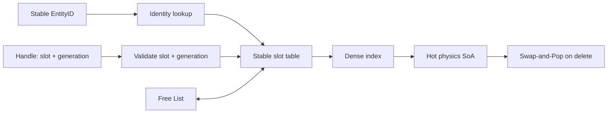
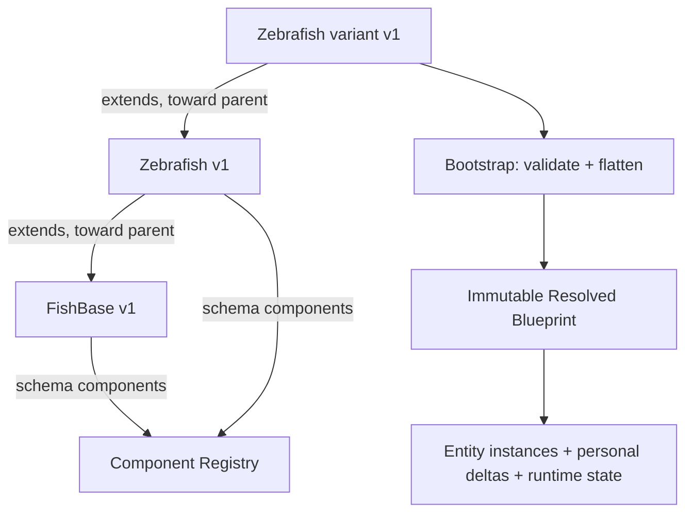

# Entity Foundations Refinement — ASCean

**Date:** 2026-11-20  
**Status:** design specification; no implementation or benchmark claim.  
**Review state:** E-001, E-002, E-003 accepted in design conversation; E-004 **pending final explicit approval**. Field Dictionary and six-stage Mechanics Development Contract agreed as design intent.  
**Relationship:** complements [DECISIONS.md](DECISIONS.md), [ARCHITECTURE.md](ARCHITECTURE.md), [ENGINE_COMPONENT_CONTRACTS.md](ENGINE_COMPONENT_CONTRACTS.md), and [WORKFLOW.md](WORKFLOW.md).

> **Visual companion:** [Entity Foundations Explorer](../site/foundations/index.html) (branch-local static page; not a deployed production claim). The existing Mechanics Lab links to it and still uses an older reference World identity prototype.

> Goal: one authoritative, scientifically accountable entity/biology engine for Ocean, Mechanics Lab, Fish Inspector and Sandbox. The lab explains the production logic, not a divergent implementation. Preserve existing anatomy and motion features before migration.

## Foundation decisions

### E-001 — Hybrid ECS and field-based storage (ACCEPTED)
- Data-oriented hot paths: compact Structure-of-Arrays (SoA) for motion/physics fields that are accessed together and updated frequently.
- Warm biological component state and cold individual/extended data organized by measured access patterns; shared immutable species reference data.
- Component/field API above storage; storage class (hot/warm/cold/shared) does not itself dictate sparse vs dense.
- Benchmark layout, cache behavior, precision and quantization before optimizations. A field list is not a per-fish memory estimate.

### E-002 — Species Blueprint and Component Registry (ACCEPTED)
- A Species Blueprint describes required/allowed components, anatomy constraints, applicable behavior/physiology models, and defaults.
- A registry validates component availability, required dependencies, contracts and species compatibility.
- Instances have independent biological and runtime state while referencing species-level definitions.
- Scientific mode prioritizes biologically supported combinations; Experimental Sandbox permits explicitly labeled, validated deviations.
- Example: zebrafish spine/gills/heart vs jellyfish bell/tentacles/nerve-net. Generic entity infrastructure does not imply interchangeable anatomy.

### E-003 — Identity and lifecycle storage (ACCEPTED)
- **Stable EntityID:** conceptually `uint64`, never reused within a world. Must remain independent of all physical storage indices. TypeScript implementation/serialization (e.g. bigint and decimal string) requires a separate implementation choice and tests.
- **Generational Handle:** `uint32 slot` + `uint32 generation`; verify both and entity live status on access. A recycled slot increments the generation. Never silently wrap generations into accidentally valid stale handles.
- **Stable slot table:** slot entries map to dense storage indices; free slots are recycled with a Free List without shifting other slots.
- **Hot physics storage:** dense SoA, removed entity uses Swap-and-Pop, update the moved entity's slot-to-dense-index mapping and the reverse mapping. External references store handles/EntityIDs, never raw pointers to movable SoA entries.
- **Sparse/stable optional registries:** only for records that truly need address/index stability. Cold data such as genome variation is not automatically sparse.
- **Ring buffers** intended for Event Queue, Sensor History, Motion History and Telemetry. Each must define overflow policy: do not silently overwrite critical domain events; bounded histories/telemetry may explicitly drop oldest samples.
- Free List recycling solves **slot reuse**; Swap-and-Pop solves **dense physics data**. These are distinct and compatible concerns.



## E-004 — Composition, contracts and limited Blueprint extends (PROPOSED: await approval)

**Separation of concerns**
1. **Composition** describes which components an entity has; no deep organism-class hierarchy.
2. **Interfaces / model contracts** specify required capabilities when multiple species-specific implementations exist. Example: fish circulation vs octopus systemic and branchial hearts. Avoid one virtual interface object per hot-path field/fish without profiling; batch by model where possible.
3. **Blueprint `extends`** reuses configuration/schema definitions; it is NOT biological parentage or C++/TypeScript class inheritance.
4. **Individual genotype** references a versioned species reference genome and stores represented variants/alleles separately. Phenotype is not automatically determined by a text or byte change without supported genotype-to-phenotype rules.
5. **Runtime state** (position, velocity, current oxygen, health, etc.) is independent from shared defaults and persistent instance configuration overrides.

**Draft rules**
- **Single direct parent:** at most one parent Blueprint for each Blueprint; unrelated to genetic reproduction, which can have two parents.
- **No cycles:** reject repeated/cyclic parents (e.g. A extends B extends A) during validation.
- **Depth:** no arbitrary hard depth cap in V1. A configurable warning threshold detects chains that may require simplification. A hard cap may be considered if evidence justifies it; traversal must still have cycle protection and practical resource safeguards.
- **Composition & dependency checks:** validate required components, model compatibility and dependency graphs before publishing resolved definitions.
- **Overrides:** allowed only per registered field/schema policy. `private` controls API access; `readonly`/`const` protect program state where applicable; schema validation protects external configuration, editing permissions and serialization. These are complementary, not interchangeable.
- **Published Blueprints:** immutable, versioned, read-only shared references. An edit produces a new version; existing entities keep their pinned version unless an explicit migration is approved.
- **Flatten on load:** recursively resolve the parent chain and merge known fields/components into a validated, immutable **Resolved Blueprint** once per loaded version (or when invalidated); cache and share it between instances. Runtime ticks do not walk the parent chain.
- **Deterministic override semantics:** explicit field IDs, documented `replace/add/remove` semantics for collection-like fields, collision rules and deterministic merge order. Invalid or unknown fields are rejected unless an explicit schema migration handles them.
- **No default duplication:** instances store no override for identical defaults; they still own identity, genotype and mutable state. A change in species-level default is not allowed to silently mutate saved organisms.



**Bootstrap (not an OS bootloader):** `Load -> Validate -> Resolve/Flatten -> Cache -> Instantiate`. Similar to a boot process in its initialization role; this does not load the operating system or access its stack. The existing `EngineBootstrap` resolves engine modules and dependencies; the new **BlueprintResolver** is a distinct, staged sub-process for species data.

### Architecture diagnostics / structured logs

| Code | Level | Condition | Outcome |
| --- | --- | --- | --- |
| `BP_INHERITANCE_DEPTH_WARN` | WARNING | Chain exceeds configurable recommendation threshold | Record structured diagnostic; allow validated Blueprint |
| `BP_INHERITANCE_CYCLE` | ERROR | `extends` revisits a Blueprint | Reject resolution |
| `BP_PARENT_MISSING` | ERROR | Missing parent/version | Reject resolution |
| `BP_COMPONENT_INCOMPATIBLE` | ERROR | Contract/dependency mismatch | Reject resolution |
| `BP_FIELD_OVERRIDE_FORBIDDEN` | ERROR | Immutable or disallowed field changed | Reject override |
| `BP_FIELD_UNKNOWN` | ERROR | Unknown FieldID without explicit migration | Reject unrecognized config |

Diagnostics record `code, level, timestamp/tick, blueprintId, blueprintVersion, parentPath, fieldId?, message, actionHint, correlationId?`; exposed to the Lab diagnostics panel and logging/telemetry as permitted. Log events are not arbitrary mutable shared flags; consumers may derive status flags and counters from structured diagnostics. No infinite recursion or silent fallback on invalid configuration. Avoid per-frame warning spam: deduplicate/rate-limit repeated diagnostics.

### Field Registry and three synchronized views (AGREED)

Every field has a stable FieldID, canonical path, owner component/system, semantic definition, data type, unit, default/validation bounds, update/read frequency, access policy, persistence policy, storage class, scientific provenance (when needed), anatomical anchors (when applicable), and complexity/memory notes.

- **Human View:** plain-language explanation and bidirectional links to precise anatomy landmarks or organs in Fish Inspector / Anatomy Lab (e.g. `body.standardLength` from snout to caudal-fin base). Do not pretend all technical fields have anatomical locations.
- **Schema View:** machine-readable typed definitions, component dependencies, field IDs and override/validation rules. Generate compact text/binary representations from this source of truth; allocate stable IDs and version the schema to support migration.
- **Memory View:** logical array/slot/index/offset, byte and bit representation, approximate allocated/resident cost and complexity. Do not invent physical addresses. Show actual virtual addresses only where measurable/allowed in the runtime.
- **Field consistency:** schema, documentation, visual anatomy link and memory representation reference the same FieldID. No arbitrary character substitution masquerading as genotype/biology.

Example conceptual field (not an approved numeric calibration):

```yaml
fieldId: 101
name: body.standardLength
type: float32
unit: cm
owner: GrowthComponent
anchors: [snout, caudalFinBase]
storage: warm
persistence: snapshot
overridePolicy: validated
description: Length from snout to caudal-fin base
```

## Performance and complexity review (AGREED)

For each new operation specify the operation, `n`, assumptions, expected/worst-case time and auxiliary space, memory overhead, and actual benchmark once implemented.

| Operation | Expected time | Extra space | Conditions |
| --- | --- | --- | --- |
| Handle validation / slot lookup | O(1) | O(1) | Direct indexed slot table |
| Dense Swap-and-Pop removal | O(1) | O(1) | Constant number of fixed-size columns; updating other attached registries can add cost |
| Spawn into reserved capacity | O(1) | O(1) | Resizing may be O(n); capacity and allocation policy must be measured |
| Update n active fish | O(n) | O(1) besides model state | Hot SoA sequential scan |
| Blueprint resolution | Proportional to processed fields and parent links | Proportional to resolved schema | One-time per version, not per Tick |

Use measured latency distribution (including p95), allocations, capacity vs count, and correctness/regression benchmarks. No invented throughput, FPS or memory claims.

## Mechanics Development Contract — six stage workflow (AGREED)

1. **Concept & Biology:** mechanism boundaries, scientific evidence, assumptions, uncertainties and expected observable behavior.
2. **Architecture & UML:** composition, interfaces, inheritance notation, dependencies and data flow.
3. **Field Contract:** stable field IDs, types, units, anatomical links, ownership, update frequency, storage class.
4. **Memory & Complexity:** layout, read/write patterns, time/space analysis, benchmarks plan.
5. **Implementation & Visual Lab:** small production module, synchronized Lab explainer and tests; preserve existing working UI/prototypes.
6. **Validation & Checkpoint:** scientific/behavioral validation, regression & device tests, exact commit/PR evidence, review, explicit owner approval and compact PCM checkpoint.

**Documentation output per mechanism:** short contract, UML/flow diagram, field dictionary entries, implementation examples, acceptance criteria, test/benchmark evidence, open issues and decisions. Do not merge/deploy without explicit approval. The public repo contains no private PCM content.

## Next review / implementation boundary

- **Pending:** explicit E-004 approval of the rules above and review of the documentation PR.
- **Next after approval:** inspect the existing Zebrafish Anatomy Engine, identify working/defective features, map actual anatomy anchors and existing field data, avoid destructive rewrites, then implement narrowly scoped integrations on a separate feature branch.
- **Not yet proven:** real data layout/overheads, gene-to-trait mapping, production BlueprintResolver, diagnostic implementation or biological calibration.
